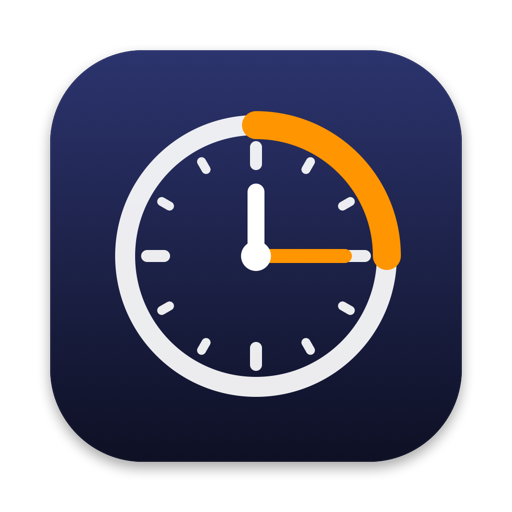

<p align="center">
  
</p>

<h1 align="center">Overtime</h1>

<p align="center">
  <em>Extra time for Intel Macs.</em><br>
  Build with the newest macOS SDK on an x64_x86 Mac, after the newest developer tools stopped running there.
</p>

<p align="center">
  <a href="https://github.com/0xfel1x/overtime-x86/releases/latest"></a>
  
  <a href="LICENSE"></a>
</p>

## In short

Newer Xcode releases install only on Apple silicon. Their macOS SDK, however, still contains
everything needed to build for Intel. Overtime puts the pieces together for you:

1. **You keep your Xcode.** The Xcode that runs on your Intel Mac stays as it is and keeps
   providing the editor, linker and signing tools.
2. **Overtime gets the newest Xcode.** One click opens Apple's download in your browser; you
   sign in with your own Apple Account, and Overtime picks up the download and unpacks it.
   Only the macOS SDK inside it is used.
3. **It makes the SDK usable on Intel.** A local copy of the SDK is adjusted so the older
   linker accepts it, and the matching open-source Swift compiler is installed from
   [swift.org](https://www.swift.org/install/macos/).
4. **It prepares Xcode.** A private copy of your Xcode is set up to build with the new SDK.
   Open your projects there. Nothing has to be changed in the projects.

The result: apps built on your Intel Mac against the newest macOS SDK, from Xcode or from
the Terminal.

## Get started

1. Download `Overtime-<version>.zip` from the
   [Releases](https://github.com/0xfel1x/overtime-x86/releases/latest) page and unpack it.
2. Open **Overtime**. It is not signed with an Apple Developer ID, so macOS blocks the first
   start: dismiss the warning, then go to System Settings > Privacy & Security and click
   **Open Anyway**.
3. Overtime finds the Xcode on your Mac. Click **Get Newest Xcode** and sign in to Apple in
   your browser. If you already have the newer Xcode, drop the app or the `.xip` file on
   the window instead.
4. Click **Set Up**. When it is done, the window shows the prepared Xcode and the commands
   for the Terminal.

### What you need

- An **Intel Mac** (was also tested on OpenCore 1.0.8) with the Xcode you use today.
- A free Apple Account to download Xcode from Apple.
- About 25 GB of free disk space during the setup (the unpacked newer Xcode is removed
  again) and about 6 GB afterwards for the Swift compiler.

## Using it

**In Xcode:** open your projects with the prepared copy, `Xcode-SDK<version>` in the
Applications folder. It builds with the newer SDK and the matching Swift compiler by itself.
To tell it apart from your normal Xcode, look at the menu bar, the Dock or the app
switcher: the copy is called "Xcode SDK 27.2" there. In a project, Build Settings >
Base SDK shows the SDK in use.
`xcodebuild` works the same way:
`DEVELOPER_DIR=/Applications/Xcode-SDK<version>.app/Contents/Developer xcodebuild ...`

**In Terminal:** add the tools to your shell once (the app copies the line for you), then:

| Command | Purpose |
| --- | --- |
| `ot-clang`, `ot-clang++` | C, C++, Objective-C |
| `ot-swiftc` | Swift compiler |
| `ot-swift build/run/test` | Swift Package Manager |

```sh
ot-swiftc -target x86_64-apple-macos13 main.swift -o app
ot-swift build -c release
otool -l app | grep -A5 LC_BUILD_VERSION   # shows the newer SDK version
```

To pin SDK, compiler and architecture for a single project, add an `.xcconfig` file to it
that contains `#include "<home>/Library/Developer/Overtime/config/local.xcconfig"` and
select it under Project > Info > Configurations.

## How it works in detail

1. `scripts/make-sdk.sh` clones the newer SDK locally. The older linker rejects the new
   architecture token `arm64e.x1` in the `.tbd` link stubs, so the local copy renames it to
   `i386`. Only x86_64 slices are linked, so the renamed entries are never used. The script
   also reads the Swift compiler version from the SDK's Swift interfaces.
2. `scripts/install-toolchain.sh` downloads exactly that Swift version from swift.org,
   checks the swift.org Developer ID signature and notarization, and installs it to
   `~/Library/Developer/Toolchains`. It records the toolchain in the SDK copy's settings,
   which is how the Xcode build system finds the matching compiler without a project
   setting.
3. `scripts/make-xcode-clone.sh` makes an APFS clone of your Xcode (almost no extra disk
   space) and links the SDK copy into it. The Xcode build system only resolves SDKs inside
   its own platform folder; as the newest SDK there, it becomes the default. Your installed
   Xcode is not touched.
4. The `ot-*` wrappers point the compilers at the SDK copy. The Swift link step gets
   `-isysroot` so binaries record the real SDK version.

The app in `App/` is a front end for these scripts. It tells the two Xcodes apart by the
processor architecture of their main program, reads the newest Xcode version from Apple's
public release feed, and unpacks the download with the system's `xip` tool. Everything is
installed to `~/Library/Developer/Overtime`.

## Build from source

```sh
scripts/build-app.sh          # add --zip to also pack it into releases/
open build/Overtime.app
```

Without the app, the same steps run in the Terminal:

```sh
scripts/setup.sh --with-ide   # leave out --with-ide to skip the Xcode copy
export PATH="$PWD/bin:$PATH"
```

Paths can be changed with environment variables (`OT_HOST_XCODE`, `OT_NEW_XCODE`,
`OT_HOME`, `OT_TOOLCHAINS_DIR`, `OT_CLONE`), see [lib/common.sh](lib/common.sh).
Run the setup again after updating either Xcode.

## Limits

- Swift deployment target must be macOS 13 or later with recent SDKs.
- A project without a deployment target defaults to the new SDK's version, which is newer
  than the macOS you are running. Set a deployment target your Mac can run.
- Asset catalogs and Interface Builder files are compiled by the older Xcode's tools,
  without features introduced later.
- No simulators of newer OS versions; the newer Xcode itself does not run.
- The built app's `Info.plist` records the newer SDK (`DTSDKName`) but the version of the
  older Xcode (`DTXcode`). Stores or services that require a minimum Xcode version may
  reject such builds.
- Signing with a Developer ID, notarization and App Store upload are not yet verified
  with this setup (ad-hoc signing works).
- `codesign --verify` reports the prepared Xcode copy as modified, because of the added
  link to the SDK. That is expected.

## Credits

The Swift compiler it installs comes from the [Swift open-source project](https://www.swift.org).

## License and legal

Scripts, app and documentation: [MIT](LICENSE). This repository contains **no Apple
software**: no SDK files, no Xcode components, no Apple artwork. You download Xcode
yourself from Apple, with your own account and under Apple's terms. Read
[LEGAL.md](LEGAL.md) before use.

Overtime is an independent project and is not affiliated with, endorsed or sponsored
by Apple Inc. Apple, Xcode, macOS and Swift are trademarks of Apple Inc. Intel is a
trademark of Intel Corporation. The names are used only to describe compatibility.
